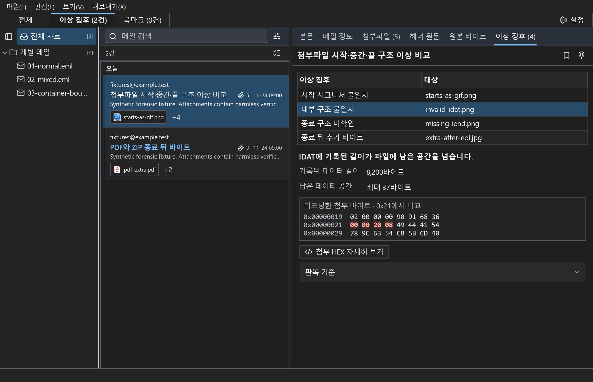

# Mail Evidence

<p align="center"></p>

<h3 align="center">A user-friendly email analysis tool built around the analyst’s workflow</h3>

<p align="center"><strong>Open mail files, folders, and disk images. Preview messages and attachments, review anomalies, and trace each finding back to its source.</strong></p>

[한국어](README.md) · [English](README.en.md) · [日本語](README.ja.md)

[Windows x64 compact](https://github.com/absolroot/Mail-Evidence/releases/download/v1.5.7/Mail-Evidence-v1.5.7-win-x64-compact.zip) · [Windows x64 with runtime](https://github.com/absolroot/Mail-Evidence/releases/download/v1.5.7/Mail-Evidence-v1.5.7-win-x64-standalone.zip) · [Rust CLI 0.4.0](https://github.com/absolroot/Mail-Evidence/releases/download/v1.5.7/Mail-Evidence-CLI-v0.4.0-win-x64.zip)

## Why use Mail Evidence?

- **Work in a familiar layout.** Browse folders, search messages as you type, and read the selected message in the same window. Pin or bookmark messages you want to revisit.
- **Start with the evidence you have.** Open individual files and folders together, or find mail on a readable NTFS volume in a disk image. Selected files are extracted with hashes and their paths in the image.
- **Read older Outlook data.** The Windows app reads ANSI and Unicode MSG files and supported older OST files. The Rust CLI also reads older PST variants and Outlook Express DBX and MBX files.
- **See what triggered a finding.** Compare actual header values, link destinations, filenames, or file bytes. Preview an attachment and go straight to the relevant source location when you need more detail.

## Quick start

1. Extract the Windows x64 ZIP and run `MailEvidence.exe`. The compact edition uses the [.NET 10 Desktop Runtime](https://dotnet.microsoft.com/en-us/download/dotnet/10.0). Keep the included `NtfsTracer.libewf.dll` next to the executable when opening E01 or Ex01 images.
2. Choose files or a folder in **Open mail sources**, or select **Disk image…** to find and extract mail. Use **Find mail files on this PC…** to look in Outlook storage locations. [Disk image workflow](docs/disk-image-mail.md)
3. Search under **All mail**, or use **Anomalies** to review flagged messages. Open the body, attachments, raw headers, or source bytes in the reading pane. [Sample messages](tests/fixtures/anomaly-ux-complete/) · [Conversation sample](tests/fixtures/conversation-history/)

**Settings → Display language** offers Korean, English, Japanese, German, Spanish, French, Indonesian, Italian, Polish, Brazilian Portuguese, Turkish, Vietnamese, Russian, Ukrainian, and Simplified and Traditional Chinese.

## Supported inputs

### Mail files and stores

| Format | Windows app | Rust CLI |
| --- | :---: | :---: |
| Internet mail `.eml` | ✓ | ✓ |
| `.nws`, `.mime`, `.rfc822` | – | ✓ |
| Mailbox `.mbox` | ✓ | ✓ |
| Outlook message `.msg` | ✓ | ✓ |
| Outlook data file `.pst` | ✓ | ✓ |
| Outlook offline data file `.ost` | ✓ | ✓ |
| Outlook Express `.dbx`, `.mbx` | – | ✓ |
| Outlook for Mac `.olm` | – | ✓ |
| Apple Mail `.emlx`, `.partial.emlx` | – | ✓ |
| `.mmdf`, `.babyl`, `.rmail`, Maildir, MH | – | ✓ |
| `.zip` containing supported mail | – | ✓ |
| TNEF `.tnef`, `winmail.dat` | – | ✓ |
| CMS SignedData with an embedded message `.p7m`, `.p7s` | – | ✓ |

✓ Supported · – Unsupported

PST and OST files are limited to **2 GiB each**. The Windows app reads Unicode 23 PST files with block encoding 0 or 1. Select extensionless MBOX files directly. [PST variants](docs/pst-verification.md) · [OST variants](docs/ost-expanded-verification.md) · [CLI format details](docs/rust-mail-cli.md)

### Disk images

| Format | Extensions |
| --- | --- |
| RAW | `.raw`, `.dd`, `.img`, split RAW starting at `.000` or `.001` |
| Physical EWF | `.e01`, `.ex01` |
| Virtual disks | `.qcow`, `.qcow2`, `.qcow3`, `.vhd`, `.vhdx`, `.vmdk` |
| AFF1 | `.aff` |

The app finds EML, MBOX, MSG, PST, and OST files on readable NTFS volumes. Logical EWF and locked BitLocker volumes are outside this workflow. [Image format limits](third_party/ntfs-tracer/modules/EvidenceImage/README.md)

### Attachment previews

| Type | Preview |
| --- | --- |
| Documents | First page of `.pdf`, `.hwp`, `.hwpx`, and `.docx` |
| Images | `.jpg`, `.jpeg`, `.png` |
| Text | Excerpts from `.txt`, `.log`, `.csv`, `.tsv`, `.json`, `.xml`, `.md`, `.ini`, `.cfg`, `.yaml`, `.yml`, and `text/*` attachments |
| Binary data | Excerpts from `.bin` and `.dat`, with printable ASCII where text decoding is not available |

[Preview limits](preview/README.md)

## Investigation features

[](docs/media/anomaly-evidence-dark.png)

- **Search and cross-reference.** Filter by date, source, attachment status, or anomaly type. Find other messages with the same address, host, URL, attachment SHA-256, or Message-ID.
- **Read messages and attachments.** Switch between HTML and plain text. External images, scripts, and link navigation are blocked by default. HTML rendering uses [Microsoft Edge WebView2 Runtime](https://learn.microsoft.com/en-us/microsoft-edge/webview2/concepts/distribution).
- **Examine source bytes.** Use the attachment toolbar to inspect the stored MIME range, MSG stream, or PST/OST property. File structure and PE findings can open the decoded attachment at the relevant offset.
- **Export and verify.** Save a message, selected messages, search results, or attachments. Verify exported file sizes and SHA-256 hashes against the manifest. Source evidence is opened read-only.

## What does Mail Evidence flag?

| Finding | Evidence shown |
| --- | --- |
| Repeated single-instance header | Each occurrence of `From`, `Sender`, `Reply-To`, `Date`, or `Message-ID` |
| Different From and Reply-To domains | The two addresses and their domains |
| Reversed relay timestamps | Adjacent `Received` timestamps reversed by at least 30 seconds |
| Different domains in an HTML link | The address shown in the link and its actual destination |
| Disguised attachment filename | A double extension or a Unicode direction control and its position |
| PE content under a document or image name | The filename, PE signature, and offset in the decoded attachment |
| Unexpected attachment structure | A mismatched start signature or internal structure, a missing end marker, or bytes after the end |
| Reply-To change in a conversation | The current address and the most recent comparable referenced message from the same sender in the preceding 30 days |

Treat findings as leads. Support services and tracking links can produce legitimate differences. Checks that could not be completed are marked separately. Authentication results are shown as recorded in the headers, with trust unverified. [Rule details](docs/investigation-rules.md) · [Attachment checks](docs/attachment-signatures.md)

## Example and related tools

Open the [attachment test message](tests/fixtures/attachment-boundaries/02-mixed.eml) and select `invalid-idat.png`. The PNG declares **8,200 bytes** for the IDAT chunk, where there is room for at most **37 bytes**. **Open full attachment hex** opens the decoded bytes at `0x21`. When you return, the same finding remains selected.

| Tool | Typical use |
| --- | --- |
| Mbox Viewer | Read and search MBOX, EML, or PST files, bookmark messages, and save attachments. [Project documentation](https://github.com/zoltanf/MboxViewer) |
| MiTeC Mail Viewer | Browse Outlook Express, Windows Mail, and Thunderbird stores in a desktop interface. [Product documentation](https://www.mitec.cz/wp/mmv/) |
| MailXaminer | Conduct email investigations with disk-image input, previews, hex views, OCR, and relationship analysis. [Product documentation](https://www.mailxaminer.com/features.html) |
| **Mail Evidence** | Review files, folders, and disk images in one workspace. Trace a finding from the observed value to its source location. |

## Process mail in batches with the Rust CLI

```powershell
./mailviewer-engine.exe report D:/Evidence/Mail
./mailviewer-engine.exe report --csv D:/Evidence/Mail | Set-Content -Encoding utf8 D:/Cases/messages.csv
$result = ./mailviewer-engine.exe extract D:/Cases/Output D:/Evidence/Mail | ConvertFrom-Json
./mailviewer-engine.exe verify $result.directory
```

`report` generates a JSON or CSV inventory. The JSON includes readable message bodies, headers, and source locations. `extract` creates `messages.csv`, `manifest.json`, and an `attachments/` directory. `verify` checks the exported attachments against their recorded sizes and SHA-256 hashes. [CLI commands and output](docs/rust-mail-cli.md)

<details>
<summary>Working with local mail stores</summary>

| Store | How to open it |
| --- | --- |
| Maildir | Select the directory containing `cur/` and `new/`. |
| MH | Select the directory containing numbered message files and `.mh_sequences`. |
| Apple Mail | The relative paths under `Messages/` and `Attachments/<message number>/<MIME part number>/` are preserved. |
| Thunderbird | Select the store directly, or use `inspect-profile thunderbird` to check `profiles.ini`, `Mail/`, and `ImapMail/`. The CLI reads the `.sbd` folder hierarchy and identifies `.msf` index files. |
| Windows Mail and Windows Live Mail | Select the store or use `inspect-profile windows-mail` to find local EML files. |
| Outlook Express | Select the store or use `inspect-profile outlook-express`. Include the folder and index files to verify how the messages are organized. |

[Local store fixtures](tests/fixtures/README.md) · [Source ranges and streams by format](docs/rust-mail-cli.md)

</details>

## Build and test

Run these commands from the checkout root on Windows with the .NET 10 SDK and Rust.

```powershell
cargo build --manifest-path preview/Cargo.toml --release --locked
dotnet build MailViewer.slnx -c Release
cargo build --manifest-path engine/Cargo.toml --release --locked
dotnet run --project tests/MailViewer.Verification -c Release -- --synthetic-only
```

[CLI usage](docs/rust-mail-cli.md) · [Test fixtures](tests/fixtures/README.md) · [EWF library build](third_party/ntfs-tracer/modules/EvidenceImage/Logical/Native/README.md) · [Dependency notices](licenses/)
