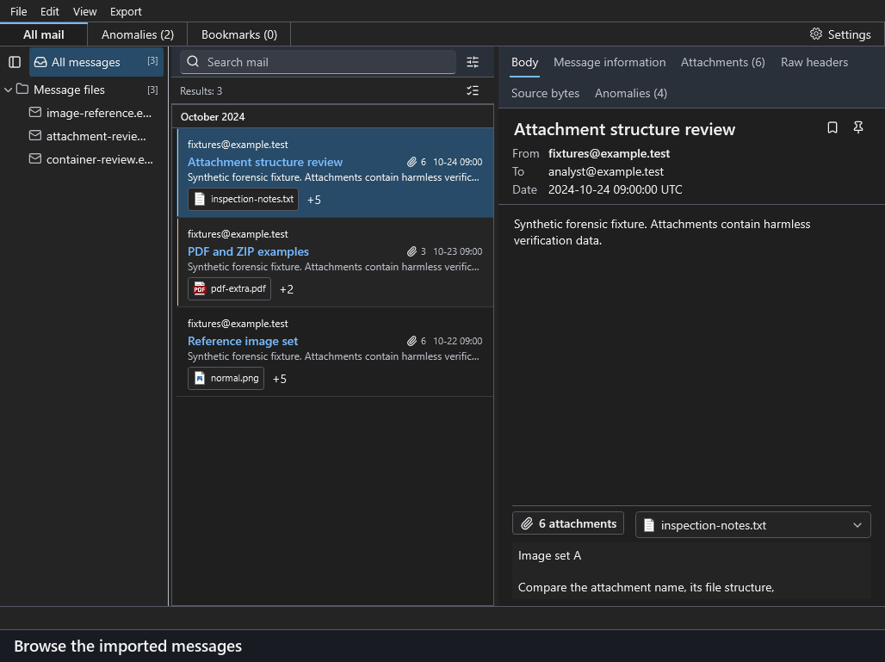
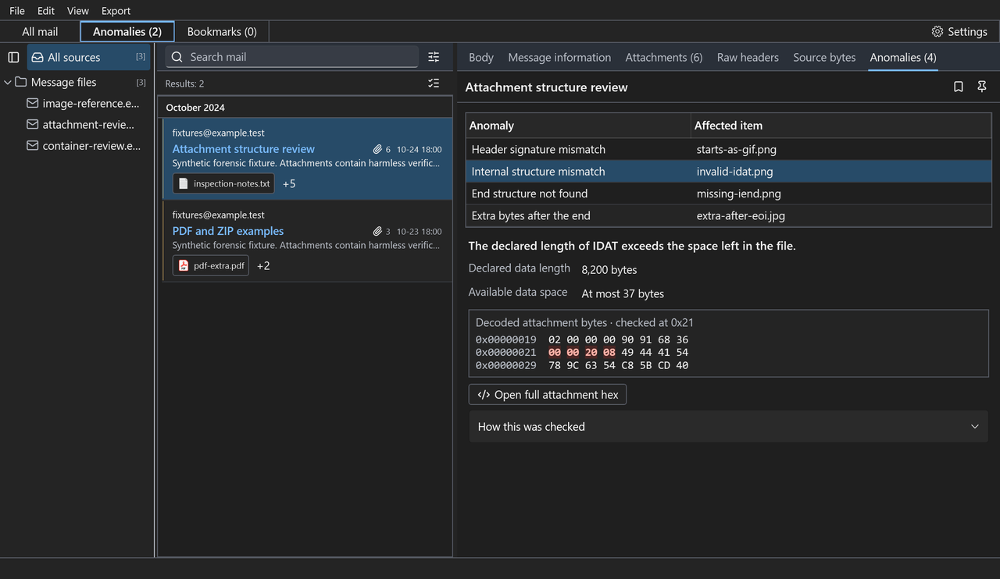

# Mail Evidence

<p align="center"></p>

<h3 align="center">調査の進めやすさを重視したメール分析ツール</h3>

<p align="center"><strong>メールファイル、フォルダー、ディスクイメージを開き、本文や添付ファイルの表示から異常の確認、元データの照合までを一つの画面で進められます。</strong></p>

[한국어](README.md) · [English](README.en.md) · [日本語](README.ja.md)

[Windows x64 軽量版](https://github.com/absolroot/Mail-Evidence/releases/download/v1.5.7/Mail-Evidence-v1.5.7-win-x64-compact.zip) · [Windows x64 ランタイム同梱版](https://github.com/absolroot/Mail-Evidence/releases/download/v1.5.7/Mail-Evidence-v1.5.7-win-x64-standalone.zip) · [Rust CLI 0.4.0](https://github.com/absolroot/Mail-Evidence/releases/download/v1.5.7/Mail-Evidence-CLI-v0.4.0-win-x64.zip)

## Mail Evidence でできること

- **使い慣れたメール画面で調査。** フォルダーを選び、入力しながらメールを検索し、選んだメールを右側の閲覧ペインで確認します。後で調べるメールにはブックマークを付けたり、一覧の先頭に固定したりできます。
- **手元の資料をまとめて確認。** メールファイルとフォルダーを一緒に開けます。ディスクイメージ内の読み取り可能な NTFS ボリュームから必要なメールを抽出し、ハッシュとイメージ内のパスを記録できます。
- **旧版 Outlook のファイルにも対応。** Windows アプリでは ANSI・Unicode の MSG と対応する旧形式の OST、Rust CLI では旧形式の PST や Outlook Express の DBX・MBX も開けます。
- **異常を検出した根拠を表示。** ヘッダー、リンク先、ファイル名、バイト列など実際に観測した値を確認し、必要に応じて元データの該当箇所を開けます。

## 使い方

1. Windows x64 用の ZIP を展開して `MailEvidence.exe` を起動します。軽量版には [.NET 10 Desktop Runtime](https://dotnet.microsoft.com/en-us/download/dotnet/10.0) が必要です。E01・Ex01 を開く場合は同梱の `NtfsTracer.libewf.dll` を実行ファイルと同じフォルダーに置きます。
2. ファイルかフォルダーを選択するか、**ディスクイメージ…** からメールを検索・抽出します。保存先が分からない場合は **この PC でメールファイルを探す…** を使います。[ディスクイメージからの抽出](docs/disk-image-mail.md)
3. 全メールを検索するか、**異常の兆候** に表示されたメールを選びます。閲覧ペインで本文、添付ファイル、ヘッダー原文、元データのバイト列を切り替えられます。[異常を含むサンプル](tests/fixtures/anomaly-ux-complete/) · [やり取りのサンプル](tests/fixtures/conversation-history/)

**設定 → 表示言語** で、韓国語、英語、日本語、ドイツ語、スペイン語、フランス語、インドネシア語、イタリア語、ポーランド語、ブラジルポルトガル語、トルコ語、ベトナム語、ロシア語、ウクライナ語、中国語（簡体字・繁体字）を選べます。

## 対応形式

### メールファイルとメールストア

| 形式 | Windows アプリ | Rust CLI |
| --- | :---: | :---: |
| インターネットメール `.eml` | ✓ | ✓ |
| `.nws`、`.mime`、`.rfc822` | – | ✓ |
| メールボックス `.mbox` | ✓ | ✓ |
| Outlook メッセージ `.msg` | ✓ | ✓ |
| Outlook データファイル `.pst` | ✓ | ✓ |
| Outlook オフラインデータファイル `.ost` | ✓ | ✓ |
| Outlook Express `.dbx`、`.mbx` | – | ✓ |
| Outlook for Mac `.olm` | – | ✓ |
| Apple Mail `.emlx`、`.partial.emlx` | – | ✓ |
| `.mmdf`、`.babyl`、`.rmail`、Maildir、MH | – | ✓ |
| 対応するメールを含む `.zip` | – | ✓ |
| TNEF `.tnef`、`winmail.dat` | – | ✓ |
| メールを内包する CMS SignedData `.p7m`、`.p7s` | – | ✓ |

✓ 対応 · – 非対応

PST・OST は **1 ファイルにつき 2 GiB** までです。Windows アプリの PST は Unicode 23 のブロックエンコード 0・1 に対応します。拡張子のない MBOX は直接選択できます。[PST の条件](docs/pst-verification.md) · [OST の条件](docs/ost-expanded-verification.md) · [CLI の対応範囲](docs/rust-mail-cli.md)

### ディスクイメージ

| 形式 | 拡張子 |
| --- | --- |
| RAW | `.raw`、`.dd`、`.img`、`.000` または `.001` から始まる分割 RAW |
| 物理 EWF | `.e01`、`.ex01` |
| 仮想ディスク | `.qcow`、`.qcow2`、`.qcow3`、`.vhd`、`.vhdx`、`.vmdk` |
| AFF1 | `.aff` |

読み取れる NTFS ボリュームから EML、MBOX、MSG、PST、OST を検索します。論理 EWF と BitLocker でロックされたボリュームは、この手順の対象外です。[イメージ形式ごとの条件](third_party/ntfs-tracer/modules/EvidenceImage/README.md)

### 添付ファイルのプレビュー

| 種類 | 表示範囲 |
| --- | --- |
| 文書 | `.pdf`、`.hwp`、`.hwpx`、`.docx` の先頭ページ |
| 画像 | `.jpg`、`.jpeg`、`.png` |
| テキスト | `.txt`、`.log`、`.csv`、`.tsv`、`.json`、`.xml`、`.md`、`.ini`、`.cfg`、`.yaml`、`.yml` と `text/*` の先頭部分 |
| バイナリ | `.bin`、`.dat` の先頭部分。文字コードを判定できないときは表示可能な ASCII 文字を確認できます。 |

[プレビューの条件](preview/README.md)

## 調査機能

[](docs/media/full-app-walkthrough-dark.gif)

- **検索と照合。** 日付、読み込んだ資料、添付ファイルの有無、異常の種類で絞り込めます。同じメールアドレス、ホスト、URL、添付ファイルの SHA-256、Message-ID を持つメールも検索できます。
- **本文と添付ファイルの確認。** HTML とプレーンテキストを切り替えられます。外部画像、スクリプト、リンク先への移動は既定でブロックされます。HTML 表示には [Microsoft Edge WebView2 Runtime](https://learn.microsoft.com/en-us/microsoft-edge/webview2/concepts/distribution) を使います。
- **元データの確認。** 添付ファイルのツールバーから MIME 内の範囲、MSG ストリーム、PST・OST プロパティを開けます。ファイル構造や PE に関する異常からは、デコードした添付ファイルの該当位置を直接開けます。
- **書き出しと再検証。** メール、選択した複数のメール、検索結果、添付ファイルを保存できます。保存したファイルの長さと SHA-256 をマニフェストと照合できます。元の資料は読み取り専用で開きます。

## 検出する異常の兆候

| 確認項目 | 表示する根拠 |
| --- | --- |
| 一度だけ記録されるヘッダーの重複 | `From`、`Sender`、`Reply-To`、`Date`、`Message-ID` に記録された各値 |
| 送信元と返信先のドメインの違い | 送信元と返信先のアドレス |
| 中継時刻の逆転 | 隣接する `Received` の時刻が 30 秒以上逆転している箇所 |
| HTML リンクのドメインの違い | リンクに表示されたアドレスと実際のリンク先 |
| 紛らわしい添付ファイル名 | 二重拡張子、または文字の表示方向を制御する Unicode 文字とその位置 |
| 文書・画像名を持つ PE ファイル | ファイル名、PE シグネチャ、デコード後のオフセット |
| 添付ファイルの構造異常 | 先頭シグネチャの不一致、内部構造の不一致、終端マーカーが見つからない箇所、終端後のデータ |
| やり取りの途中で返信先が変更 | 直前 30 日に同じ送信元から届いた参照メールのうち、比較可能な最新メールと現在の返信先 |

検出結果は調査の手掛かりです。正規のサポート窓口や計測用のリンクでも違いが生じる場合があります。確認できなかった項目は別に表示します。メール認証の結果は保存されたヘッダーの記録を示し、信頼性は未確認と表示します。[判定ルール](docs/investigation-rules.md) · [添付ファイルの構造検査](docs/attachment-signatures.md)

## 調査例と関連ツール

[添付ファイル検証用メール](tests/fixtures/attachment-boundaries/02-mixed.eml) を開いて `invalid-idat.png` を選びます。PNG の IDAT には **8,200 バイト**と記録されていますが、使える領域は **37 バイト**です。**添付ファイルの 16 進表示を開く**を選ぶと、デコード後の `0x21` を確認できます。戻ると、選択していた項目がそのまま表示されます。

[](docs/media/anomaly-evidence-dark.png)

| ツール | 主な用途 |
| --- | --- |
| Mbox Viewer | MBOX・EML・PST の閲覧と検索、メールのブックマーク、添付ファイルの保存。[プロジェクトの説明](https://github.com/zoltanf/MboxViewer) |
| MiTeC Mail Viewer | Outlook Express、Windows Mail、Thunderbird のメールストアの閲覧。[製品情報](https://www.mitec.cz/wp/mmv/) |
| MailXaminer | ディスクイメージの取り込み、添付ファイルのプレビュー、16 進表示、OCR や関係分析を用いたメール調査。[製品情報](https://www.mailxaminer.com/features.html) |
| **Mail Evidence** | 複数のローカル資料を一つの画面で読み込み、検出した異常から観測値と元データの位置をたどります。 |

## Rust CLI でメールを一括処理する

```powershell
./mailviewer-engine.exe report D:/Evidence/Mail
./mailviewer-engine.exe report --csv D:/Evidence/Mail | Set-Content -Encoding utf8 D:/Cases/messages.csv
$result = ./mailviewer-engine.exe extract D:/Cases/Output D:/Evidence/Mail | ConvertFrom-Json
./mailviewer-engine.exe verify $result.directory
```

`report` でメール一覧を JSON または CSV に出力します。JSON には読み取れた本文、ヘッダー、元データ内の位置も含まれます。`extract` は `messages.csv`、`manifest.json`、`attachments/` を作成します。`verify` は保存した添付ファイルのサイズと SHA-256 をマニフェストと照合します。[CLI のコマンドと出力](docs/rust-mail-cli.md)

<details>
<summary>ローカルに保存されたメールを開く</summary>

| 形式・アプリ | 開き方 |
| --- | --- |
| Maildir | `cur/` と `new/` があるフォルダーを指定します。 |
| MH | ファイル名が数字のメールと `.mh_sequences` があるフォルダーを指定します。 |
| Apple Mail | `Messages/` と `Attachments/<メール番号>/<MIME パート番号>/` の相対パスを保持します。 |
| Thunderbird | メールの保存先を直接指定するか、`inspect-profile thunderbird` で `profiles.ini`、`Mail/`、`ImapMail/` を確認します。`.sbd` のフォルダー階層を読み込み、`.msf` をインデックスとして識別します。 |
| Windows Mail・Windows Live Mail | 保存先を指定するか、`inspect-profile windows-mail` でローカルの EML ファイルを探します。 |
| Outlook Express | 保存先を指定するか、`inspect-profile outlook-express` を使います。フォルダー情報とインデックスのファイルも指定すると、メールの格納先を照合できます。 |

[ローカルメールの検証用データ](tests/fixtures/README.md) · [形式別の元データ範囲とストリーム](docs/rust-mail-cli.md)

</details>

## ビルドとテスト

Windows 上で .NET 10 SDK と Rust を使用し、リポジトリのルートで実行します。

```powershell
cargo build --manifest-path preview/Cargo.toml --release --locked
dotnet build MailViewer.slnx -c Release
cargo build --manifest-path engine/Cargo.toml --release --locked
dotnet run --project tests/MailViewer.Verification -c Release -- --synthetic-only
```

[CLI の使い方](docs/rust-mail-cli.md) · [検証用データ](tests/fixtures/README.md) · [EWF ライブラリのビルド](third_party/ntfs-tracer/modules/EvidenceImage/Logical/Native/README.md) · [依存ライブラリのライセンス](licenses/)

英語の画面画像と操作デモを作り直すには、Windows に Pillow をインストールして `python tools/update-readme-media.py` を実行します。
