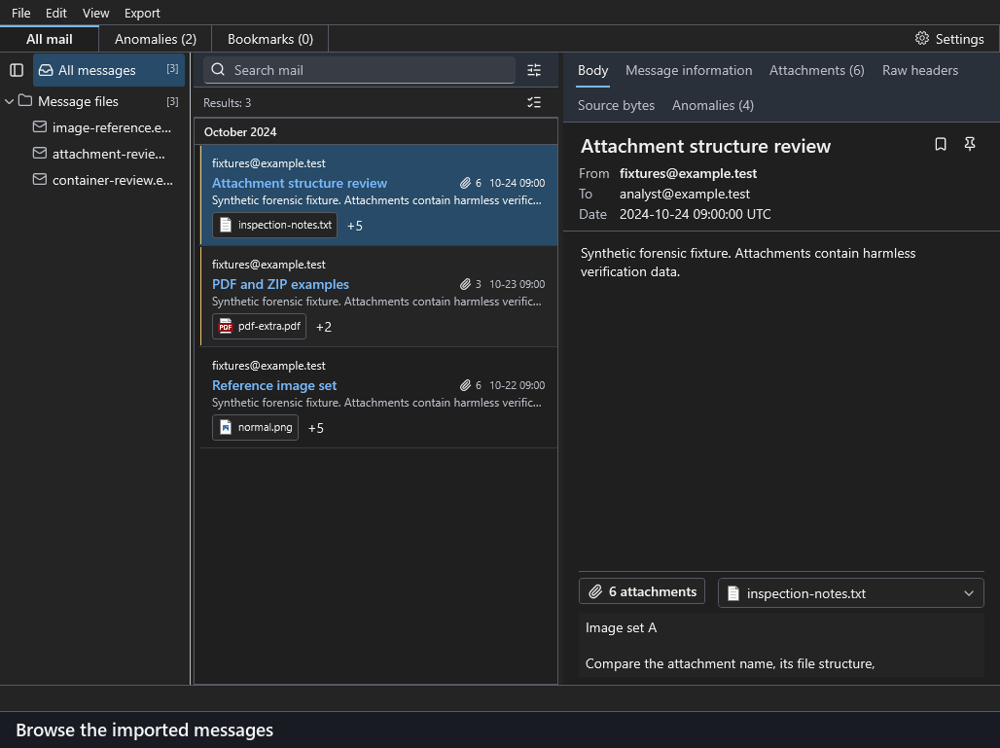
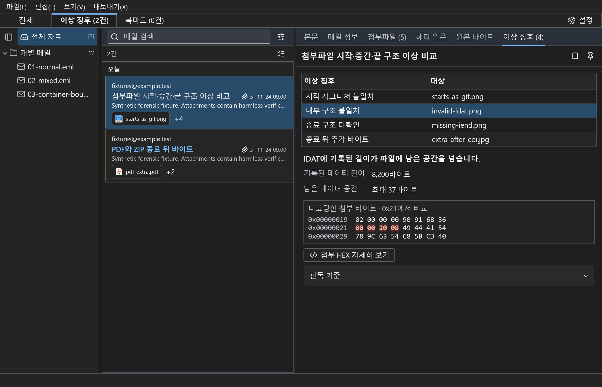

<p align="center">
  
</p>

<h1 align="center">Mail Evidence</h1>

<h3 align="center">분석 경험을 고려한 사용자 친화적인 이메일 분석 도구</h3>

<p align="center">Mail Evidence는 익숙한 메일 화면에서 증거를 살펴볼 수 있는 Windows 앱입니다. 메일 파일과 폴더를 열거나 NTFS 디스크 이미지에서 메일을 추출할 수 있습니다. 첨부 미리보기를 확인하고, 이상 징후가 보이면 근거가 된 헤더나 원본 바이트까지 대조할 수 있습니다.</p>

<p align="center">
  <a href="https://github.com/absolroot/Mail-Evidence/releases/latest"></a>
  <a href="https://www.codefactor.io/repository/github/absolroot/mail-evidence/issues/main"></a>
  <a href="https://github.com/absolroot/Mail-Evidence/actions/workflows/ci.yml"></a>
  <a href="LICENSE"></a>
</p>

<p align="center"><a href="https://github.com/absolroot/Mail-Evidence/releases/download/v1.6.0/Mail-Evidence-v1.6.0-win-x64-compact.zip">Windows x64 경량판 1.6.0</a> · <a href="https://github.com/absolroot/Mail-Evidence/releases/download/v1.6.0/Mail-Evidence-v1.6.0-win-x64-standalone.zip">Windows x64 런타임 포함판 1.6.0</a> · <a href="https://github.com/absolroot/Mail-Evidence/releases/download/v1.5.7/Mail-Evidence-CLI-v0.4.0-win-x64.zip">Rust CLI 0.4.0</a></p>

<p align="center"><a href="#시작하기">시작하기</a> · <a href="#조사-기능">조사 기능</a> · <a href="#어떤-자료를-열-수-있나요">지원 형식</a></p>

<p align="center"><a href="README.md">English</a> · <a href="README.ja.md">日本語</a></p>

## 조사 기능

[](docs/media/full-app-walkthrough-dark.gif)

영어 데모에 사용한 [샘플 메일함 24통](tests/fixtures/readme-demo/)을 열어 이미지 미리보기와 이상 징후를 직접 확인할 수 있습니다.

- 폴더, 메일 목록, 읽기 창을 한 화면에 두고 입력과 동시에 검색합니다. 중요한 메일은 북마크하거나 상단에 고정할 수 있습니다.
- 메일 파일과 폴더를 함께 열고, NTFS 디스크 이미지에서 필요한 메일을 골라 추출합니다. Windows 앱에서 구형 PST, Outlook Express의 DBX·MBX, Apple Mail의 EMLX도 직접 열 수 있습니다.
- 첨부를 미리 보고, 이상 징후에서 헤더·링크 주소·파일 바이트를 대조합니다. 같은 주소, URL, Message-ID, 첨부 SHA-256이 나온 메일을 다시 찾을 수 있습니다.
- 원본은 읽기 전용으로 엽니다. 메일, 검색 결과, 첨부를 내보내고 저장 파일의 길이와 SHA-256을 다시 확인할 수 있습니다.

## 시작하기

1. Windows x64 ZIP을 풀고 `MailEvidence.exe`를 실행합니다. 경량판에는 [.NET 10 Desktop Runtime(x64)](https://dotnet.microsoft.com/en-us/download/dotnet/10.0)이 필요합니다.
2. **메일 자료 열기**에서 파일이나 폴더를 추가하고 **분석 시작**을 누릅니다. Outlook 파일의 위치를 모르면 **이 PC에서 메일 파일 찾기…** 메뉴를 사용하세요. [디스크 이미지에서 메일 찾기](docs/disk-image-mail.md)
3. **전체**에서 메일을 검색하거나 **이상 징후**에서 확인할 메일을 고릅니다. 바로 시험하려면 [합성 샘플](tests/fixtures/README.md)을 열어 보세요.

HTML 본문은 외부 이미지, 스크립트와 링크 이동을 기본 차단합니다. HTML 표시에 [Microsoft Edge WebView2 Runtime](https://learn.microsoft.com/en-us/microsoft-edge/webview2/concepts/distribution)을 사용합니다.

## 어떤 자료를 열 수 있나요?

### 메일 파일과 저장소

흔히 쓰이는 메일 파일 형식은 거의 다 엽니다. Outlook Express 시절의 메일함도 열 수 있습니다.

| 형식 | Windows 앱 | Rust CLI |
| --- | :---: | :---: |
| 인터넷 메일 `.eml` | ✓ | ✓ |
| `.nws`, `.mime`, `.rfc822` | ✓ | ✓ |
| 메일함 `.mbox` | ✓ | ✓ |
| Outlook 메일 `.msg` | ✓ | ✓ |
| Outlook 보관함 `.pst` | ✓ | ✓ |
| Outlook 오프라인 메일 `.ost` | ✓ | ✓ |
| Outlook Express `.dbx`, `.mbx` | ✓ | ✓ |
| Outlook for Mac `.olm` | ✓ | ✓ |
| Apple Mail `.emlx`, `.partial.emlx` | ✓ | ✓ |
| `.mmdf`, `.babyl`, `.rmail`, Maildir, MH | ✓ | ✓ |
| 메일이 들어 있는 `.zip` | ✓ | ✓ |
| TNEF `.tnef`, `winmail.dat` | ✓ | ✓ |
| 메일이 포함된 CMS SignedData `.p7m`, `.p7s` | ✓ | ✓ |

PST·OST는 파일당 최대 **2 GiB**입니다. 512바이트 페이지는 ANSI 14·15와 Unicode 21·23에서 인코딩 0·1·2를, 4 KiB 페이지는 Unicode 36에서 인코딩 0을 읽습니다. EDB·NSF는 형식 식별까지 지원합니다. 새 Outlook 전용 캐시, 보호된 OST, 서버에만 남은 메일과 삭제된 항목 복구는 지원 범위 밖입니다. [Windows 판독과 원본 검증](docs/windows-format-coverage.md) · [CLI 형식별 지원 범위](docs/rust-mail-cli.md#inputs-and-attachments)

### 디스크 이미지

| 이미지 형식 | 확장자 |
| --- | --- |
| RAW | `.raw`, `.dd`, `.img`, `.000`·`.001`부터 이어지는 분할 RAW |
| 물리 EWF | `.e01`, `.ex01` 및 이어지는 세그먼트 |
| QEMU·가상 디스크 | `.qcow`, `.qcow2`, `.qcow3`, `.vhd`, `.vhdx`, `.vmdk` |
| AFF1 | `.aff` |

Windows 앱은 읽을 수 있는 NTFS 볼륨에서 EML·MBOX·MSG·PST·OST와 DBX·EMLX·OLM 등 지원 형식을 찾습니다. 형식에 따라 분할·압축 방식에 제약이 있으며, 잠긴 BitLocker와 논리 EWF(`.l01`, `.lx01`)는 이 메일 추출 흐름의 지원 범위 밖입니다. [메일 추출 절차](docs/disk-image-mail.md) · [NTFS Tracer 이미지 모듈의 상세 지원 조건](third_party/ntfs-tracer/modules/EvidenceImage/README.md)

### 첨부 미리보기

| 종류 | 확장자와 표시 범위 |
| --- | --- |
| 문서 | `.pdf`, `.hwp`, `.hwpx`, `.docx`의 첫 페이지 |
| 기타 Office 문서 | `.doc`, `.ppt`, `.pptx`의 텍스트와 `.xls`, `.xlsx`의 셀 값 |
| 압축 파일 | `.zip`, `.tar`, `.7z`에 들어 있는 파일과 폴더 이름 및 확인된 암호 보호 상태 |
| 이미지 | `.jpg`, `.jpeg`, `.png` 이미지 |
| 텍스트 | `.txt`, `.log`, `.csv`, `.tsv`, `.json`, `.xml`, `.md`, `.ini`, `.cfg`, `.yaml`, `.yml` 및 `text/*` 첨부의 앞부분 |
| 바이너리·데이터 | `.bin`, `.dat`의 앞부분. 텍스트로 읽기 어려운 바이트는 표시 가능한 ASCII 문자 위주로 보여 줍니다. |

Office 문서의 텍스트와 압축 파일 목록은 각각 최대 64 KiB까지 표시합니다. 압축 파일의 내부 항목은 풀지 않고 이름만 표시합니다. 암호화된 ZIP·7z에서 파일명을 읽을 수 있으면 목록과 함께 암호 보호 상태를 표시합니다. 7z의 파일명까지 암호화되어 있으면 암호가 필요하다고 표시합니다.

[미리보기 제한](preview/README.md)

## 어떤 이상 징후를 찾나요?

| 징후 | 바로 확인할 수 있는 근거 |
| --- | --- |
| **단일 헤더 중복** | `From`, `Sender`, `Reply-To`, `Date`, `Message-ID` 중 두 번 이상 기록된 헤더의 값과 원문을 봅니다. |
| **발신·회신 도메인 차이** | 단일 발신 주소와 단일 회신 주소가 가리키는 도메인을 비교합니다. |
| **경유 기록의 시각 역전** | 인접한 `Received` 기록 두 건의 시각이 전송 순서에서 30초 이상 역전된 경우, 두 시각과 차이를 봅니다. |
| **HTML 링크의 도메인 차이** | 화면에 주소로 표시된 URL과 실제 연결 주소의 등록 가능 도메인 또는 IP를 비교합니다. |
| **첨부 이름의 위장 징후** | 문서·이미지 확장자 뒤의 실행·스크립트 확장자 또는 파일명에 포함된 방향 제어 문자의 위치와 코드를 확인합니다. |
| **첨부 이름과 PE 형식 불일치** | 문서·이미지 이름을 가진 첨부에서 확인된 Windows PE 헤더, 시그니처와 디코딩한 바이트 위치를 봅니다. |
| **첨부파일 구조 이상** | 시작 시그니처 불일치, 내부 구조 불일치, 종료 구조 미확인, 종료 뒤 추가 바이트를 각각 표시합니다. 확인한 범위를 HEX로 대조합니다. |
| **대화 내 회신 주소 변경** | 열린 자료에서 이 메일이 참조한 직전 30일의 비교 가능한 같은 발신자 메일 중 가장 최근 메일과 현재 메일의 회신 주소를 나란히 봅니다. |

이상 징후는 조사에 참고할 관측값입니다. 정상 고객지원 주소나 추적 링크에서도 차이가 생길 수 있습니다. SPF·DKIM·DMARC는 헤더에 기록된 값을 신뢰 미확인으로 표시합니다. [규칙과 판독 범위](docs/investigation-rules.md) · [첨부 시그니처](docs/attachment-signatures.md)

## 샘플로 확인하기

[첨부 구조 샘플](tests/fixtures/attachment-boundaries/02-mixed.eml)을 열고 **이상 징후**에서 `invalid-idat.png`를 선택하세요. PNG의 IDAT 청크에는 **8,200바이트**가 기록돼 있지만, 남은 공간은 **최대 37바이트**입니다. **첨부 HEX 자세히 보기**에서 디코딩한 첨부의 `0x21` 위치를 확인할 수 있습니다.

[](docs/media/anomaly-evidence-dark.png)

[합성 메일 샘플 목록](tests/fixtures/README.md#mail-test-fixtures)에서 일상 메일과 대화 이력을 확인할 수 있습니다.

## 빌드와 검증

Windows 앱에는 .NET 10 SDK가 필요합니다. 첨부 미리보기 워커와 CLI는 Rust로 빌드합니다.

```powershell
cargo build --manifest-path preview/Cargo.toml --release --locked
cargo build --manifest-path engine/Cargo.toml --release --locked
dotnet build MailViewer.slnx -c Release
dotnet run --project tests/MailViewer.Verification -c Release -- --synthetic-only
```

[CLI 명령](docs/rust-mail-cli.md) · [샘플과 검증 명령](tests/fixtures/README.md) · [화면 검증](docs/ui-verification.md) · [EWF DLL 빌드](third_party/ntfs-tracer/modules/EvidenceImage/Logical/Native/README.md) · [라이선스 고지](licenses/)

Windows 배포는 `tools/publish-mail-evidence.ps1`을 사용합니다. 영어 스크린샷과 GIF는 Windows에서 위 명령으로 첨부 미리보기 모듈을 빌드하고 Pillow를 설치한 뒤 `python tools/update-readme-media.py`로 갱신할 수 있습니다.

## 표시 언어

**보기 → 표시 언어**에서 16개 언어 중 하나를 선택할 수 있습니다. 선택한 언어는 즉시 적용됩니다.

English · 한국어 · 日本語 · Deutsch · Español · Français · Bahasa Indonesia · Italiano · Polski · Português (Brasil) · Türkçe · Tiếng Việt · Русский · Українська · 简体中文 · 繁體中文

## 라이선스

프로젝트 자체 코드는 [Apache License 2.0](LICENSE)에 따라 공개합니다.

외부 구성 요소에는 각 구성 요소의 라이선스가 적용됩니다. [외부 구성 요소의 라이선스 고지](licenses/)를 참고하세요.
