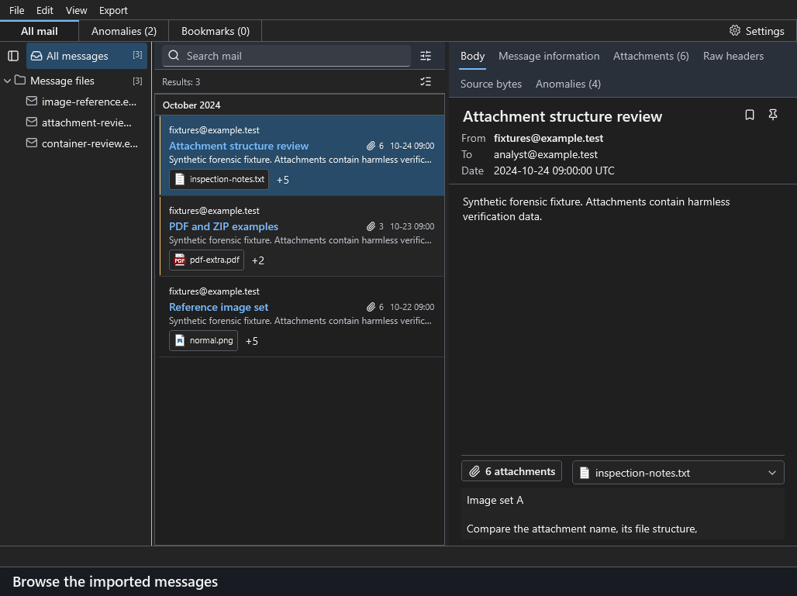
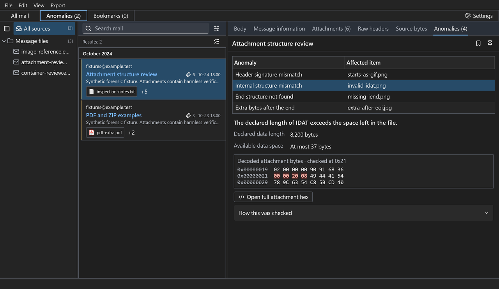

# Mail Evidence

<p align="center"></p>

<h3 align="center">분석 경험을 고려한 사용자 친화적인 이메일 분석 도구</h3>

<p align="center"><strong>메일 파일·폴더·디스크 이미지를 열어, 본문과 첨부 미리보기부터 헤더와 HEX 대조까지 한 앱에서 진행할 수 있습니다.</strong></p>

[한국어](README.md) · [English](README.en.md) · [日本語](README.ja.md)

[Windows x64 경량판 1.5.7](https://github.com/absolroot/Mail-Evidence/releases/download/v1.5.7/Mail-Evidence-v1.5.7-win-x64-compact.zip) · [Windows x64 런타임 포함판 1.5.7](https://github.com/absolroot/Mail-Evidence/releases/download/v1.5.7/Mail-Evidence-v1.5.7-win-x64-standalone.zip) · [Rust CLI 0.4.0](https://github.com/absolroot/Mail-Evidence/releases/download/v1.5.7/Mail-Evidence-CLI-v0.4.0-win-x64.zip)

## 왜 Mail Evidence를 쓰나요?

- **메일 앱을 쓰듯 조사합니다.** 왼쪽에서 폴더를 고르고, 가운데 목록에서 메일을 검색하고, 오른쪽에서 읽습니다. 입력과 동시에 검색 결과가 바뀌고, 중요한 메일은 북마크하거나 목록 상단에 고정할 수 있습니다.
- **파일·폴더·디스크 이미지에서 시작할 수 있습니다.** 개별 메일과 여러 메일함을 함께 열 수 있습니다. 읽을 수 있는 NTFS 이미지에서는 메일 파일을 찾아 선택한 항목을 추출하고, 해시와 이미지 내 출처를 남깁니다.
- **구형 Outlook 자료도 확인합니다.** Windows 앱에서 ANSI·Unicode MSG와 지원 범위의 구형 ANSI OST를 엽니다. Rust CLI는 구형 PST, Outlook Express 4의 MBX와 5·6의 DBX까지 읽습니다.
- **첨부를 바로 보고 의심스러운 지점을 대조합니다.** PDF·한글·Word 문서와 JPG·PNG를 선택하면 미리보기가 열립니다. **이상 징후** 탭에는 메일을 열어 하나씩 살펴보기 전에 비교할 후보가 모입니다. 첨부 구조가 어긋났다면 근거 바이트를 먼저 보고 해당 위치의 전체 HEX를 열 수 있습니다.

## 시작하기

64비트 Windows에서 내려받은 ZIP을 풀고 `MailEvidence.exe`를 실행하세요. 경량판에는 [.NET 10 Windows Desktop Runtime(x64)](https://dotnet.microsoft.com/en-us/download/dotnet/10.0)이 필요합니다. E01·Ex01 이미지를 열 때는 배포 폴더의 `NtfsTracer.libewf.dll`을 실행 파일과 같은 폴더에 두세요.

1. **메일 자료 열기**에서 파일 또는 폴더를 선택하거나 끌어 놓고 **분석 시작**을 누르세요. 위치를 모르면 **이 PC에서 메일 파일 찾기…**로 Outlook 저장 위치나 지정한 폴더를 검색할 수 있습니다.
2. 디스크 이미지가 있다면 **디스크 이미지…**에서 NTFS 볼륨을 고르세요. 후보 중 필요한 파일을 추출한 뒤 **분석 시작**을 누르면 됩니다. [디스크 이미지에서 메일 찾기](docs/disk-image-mail.md)
3. **전체**에서 메일을 검색하거나 **이상 징후**에서 확인할 메일을 고르세요. 읽기 창에서 본문, 첨부, 헤더 원문과 원본 바이트를 오갈 수 있습니다. [이상 징후별 합성 메일](tests/fixtures/anomaly-ux-complete/README.md) · [회신 주소 변경 샘플](tests/fixtures/conversation-history/README.md)

**설정 → 표시 언어**에서 한국어, 영어, 일본어, 독일어, 스페인어, 프랑스어, 인도네시아어, 이탈리아어, 폴란드어, 브라질 포르투갈어, 튀르키예어, 베트남어, 러시아어, 우크라이나어, 중국어 간체·번체를 선택할 수 있습니다.

## 어떤 자료를 열 수 있나요?

### 메일 파일과 저장소

| 형식 | Windows 앱 | Rust CLI |
| --- | :---: | :---: |
| 인터넷 메일 `.eml` | ✓ | ✓ |
| `.nws`, `.mime`, `.rfc822` | – | ✓ |
| 메일함 `.mbox` | ✓ | ✓ |
| Outlook 메일 `.msg` | ✓ | ✓ |
| Outlook 보관함 `.pst` | ✓ | ✓ |
| Outlook 캐시 `.ost` | ✓ | ✓ |
| Outlook Express `.dbx`, `.mbx` | – | ✓ |
| Outlook for Mac `.olm` | – | ✓ |
| Apple Mail `.emlx`, `.partial.emlx` | – | ✓ |
| `.mmdf`, `.babyl`, `.rmail`, Maildir, MH | – | ✓ |
| 메일이 들어 있는 `.zip` | – | ✓ |
| TNEF `.tnef`, `winmail.dat` | – | ✓ |
| 내장 메일이 있는 CMS SignedData `.p7m`, `.p7s` | – | ✓ |

✓ 지원 · – 미지원

PST·OST는 파일당 최대 **2 GiB**이며, Windows 앱의 PST는 Unicode 23(인코딩 0·1)을 지원합니다. 확장자 없는 MBOX는 직접 선택해 열 수 있습니다. [PST 판독 조건](docs/pst-verification.md) · [OST 판독 조건](docs/ost-expanded-verification.md) · [CLI 형식별 지원 범위](docs/rust-mail-cli.md#입력과-첨부)

### 디스크 이미지

| 이미지 형식 | 확장자 |
| --- | --- |
| RAW | `.raw`, `.dd`, `.img`, `.000`·`.001`부터 이어지는 분할 RAW |
| 물리 EWF | `.e01`, `.ex01` 및 이어지는 세그먼트 |
| QEMU·가상 디스크 | `.qcow`, `.qcow2`, `.qcow3`, `.vhd`, `.vhdx`, `.vmdk` |
| AFF1 | `.aff` |

Windows 앱은 읽을 수 있는 NTFS 볼륨에서 `.eml`, `.mbox`, `.msg`, `.pst`, `.ost`를 찾습니다. 형식에 따라 분할·압축 방식에 제약이 있으며, 잠긴 BitLocker와 논리 EWF(`.l01`, `.lx01`)는 이 메일 추출 흐름의 지원 범위 밖입니다. [메일 추출 절차](docs/disk-image-mail.md) · [NTFS Tracer 이미지 모듈의 상세 지원 조건](third_party/ntfs-tracer/modules/EvidenceImage/README.md)

### 첨부 미리보기

| 종류 | 확장자와 표시 범위 |
| --- | --- |
| 문서 | `.pdf`, `.hwp`, `.hwpx`, `.docx`의 첫 페이지 |
| 이미지 | `.jpg`, `.jpeg`, `.png` 이미지 |
| 텍스트 | `.txt`, `.log`, `.csv`, `.tsv`, `.json`, `.xml`, `.md`, `.ini`, `.cfg`, `.yaml`, `.yml` 및 `text/*` 첨부의 앞부분 |
| 바이너리·데이터 | `.bin`, `.dat`의 앞부분. 텍스트로 읽기 어려운 바이트는 표시 가능한 ASCII 문자 위주로 보여 줍니다. |

형식과 크기 조건에 맞으면 첨부를 선택할 때 미리보기가 자동으로 열립니다. [첨부 미리보기의 세부 범위와 한도](preview/README.md)

## 조사 기능

[](docs/media/full-app-walkthrough-dark.gif)

- **메일 찾기와 분류** 제목·발신자·수신자·본문·첨부 이름으로 검색하고, 날짜·자료·첨부 유무·이상 징후 유형으로 결과를 좁힙니다. 주소·호스트·URL·첨부 SHA-256·Message-ID가 같은 다른 메일도 찾을 수 있습니다.
- **본문과 관련 메일** HTML 본문을 기본으로 열고 평문으로 전환할 수 있습니다. 외부 이미지와 스크립트, 링크 이동은 기본 차단되며, 본문 링크를 누르면 기록된 URL과 호스트를 확인할 수 있습니다. 관련 메일은 참조 헤더를 따라 엽니다. HTML 표시에는 [Microsoft Edge WebView2 Runtime](https://learn.microsoft.com/en-us/microsoft-edge/webview2/concepts/distribution)이 필요합니다.
- **첨부 미리보기와 파일 정보** 파일 목록 옆에서 첨부를 미리 봅니다. 영역을 늘리거나 넓게 열 수 있고, 미리보기 아래에서 파일명·크기·MIME 유형·SHA-256·원본 위치를 확인할 수 있습니다.
- **헤더·첨부 원본과 HEX** 편하게 읽을 수 있는 메일 정보와 원문 헤더를 함께 제공합니다. 첨부 탭의 **HEX**는 저장된 MIME 범위, MSG 스트림 또는 PST·OST 속성을 엽니다. 구조 이상이나 PE 시그니처의 **첨부 HEX 자세히 보기**는 디코딩한 첨부의 해당 위치를 엽니다. [첨부파일 구조 검사](docs/attachment-signatures.md)
- **내보내기와 재검증** 선택한 메일, 체크한 메일, 검색 결과 또는 첨부를 별도 경로에 저장합니다. 매니페스트에 기록된 길이와 SHA-256을 다시 대조할 수 있습니다. 메일 원본은 읽기 전용으로 엽니다.

## 어떤 이상 징후를 찾나요?

상단의 **이상 징후** 탭에는 징후가 있는 메일이 모입니다. 메일을 선택하면 읽기 창에서 실제 비교값을 먼저 확인하고, 필요한 경우 판독 기준이나 원본 위치를 열 수 있습니다. 고객지원 서비스의 회신 주소나 정상 추적 링크에서도 차이가 생길 수 있습니다. 판독하지 못한 범위는 따로 표시합니다.

| 징후 | 바로 확인할 수 있는 근거 |
| --- | --- |
| **단일 헤더 중복** | `From`, `Sender`, `Reply-To`, `Date`, `Message-ID` 중 두 번 이상 기록된 헤더의 값과 원문을 봅니다. |
| **발신·회신 도메인 차이** | 단일 발신 주소와 단일 회신 주소가 가리키는 도메인을 비교합니다. |
| **경유 기록의 시각 역전** | 인접한 `Received` 기록 두 건의 시각이 전송 순서에서 30초 이상 역전된 경우, 두 시각과 차이를 봅니다. |
| **HTML 링크의 도메인 차이** | 화면에 주소로 표시된 URL과 실제 연결 주소의 등록 가능 도메인 또는 IP를 비교합니다. |
| **첨부 이름의 위장 징후** | 문서·이미지 확장자 뒤의 실행·스크립트 확장자 또는 파일명에 포함된 방향 제어 문자의 위치와 코드를 확인합니다. |
| **첨부 이름과 PE 형식 불일치** | 문서·이미지 이름을 가진 첨부에서 확인된 Windows PE 헤더, 시그니처와 디코딩한 바이트 위치를 봅니다. |
| **첨부파일 시작·끝 구조 이상** | 시작 시그니처 불일치, 내부 구조 불일치, 종료 구조 미확인, 종료 뒤 추가 바이트를 각각 표시합니다. 확인한 범위를 HEX로 대조합니다. |
| **대화 내 회신 주소 변경** | 열린 자료에서 이 메일이 참조한 직전 30일의 비교 가능한 같은 발신자 메일 중 가장 최근 메일과 현재 메일의 회신 주소를 나란히 봅니다. |

헤더에 기록된 SPF·DKIM·DMARC 등 인증 결과는 **신뢰 미확인**으로 표시합니다. [규칙 구현과 검수](docs/investigation-rules.md) · [첨부파일 구조 검사에 쓰는 확장자와 시그니처](docs/attachment-signatures.md)

## 조사 예시와 도구 비교

[첨부 구조 검증 샘플](tests/fixtures/attachment-boundaries/02-mixed.eml)을 열면 이상 징후 네 건이 표시됩니다. `invalid-idat.png`를 고르면 PNG에 기록된 **8,200바이트**와 파일에 들어갈 수 있는 **최대 37바이트**를 즉시 비교할 수 있습니다. **첨부 HEX 자세히 보기**를 누르면 디코딩한 바이트의 `0x21` 위치가 열리고, 돌아오면 같은 징후가 선택됩니다.

[](docs/media/anomaly-evidence-dark.png)

| 도구 | 공식 문서에서 확인한 쓰임 |
| --- | --- |
| Mbox Viewer (zoltanf) | 개별 MBOX·EML·PST를 열어 본문을 검색하고, 북마크하거나 첨부와 메일을 저장할 수 있습니다. [프로젝트 문서](https://github.com/zoltanf/MboxViewer) |
| MiTeC Mail Viewer | 구형 Outlook Express, Windows Mail, Thunderbird 저장소를 GUI로 열고 HTML 본문과 첨부를 볼 수 있습니다. [공식 기능 안내](https://www.mitec.cz/wp/mmv/) |
| MailXaminer | 메일·디스크 이미지 분석, 첨부 미리보기와 메일 HEX, OCR과 관계 분석을 지원하는 포렌식 제품입니다. [공식 기능 안내](https://www.mailxaminer.com/features.html) |
| **Mail Evidence** | 익숙한 폴더·메일 목록·읽기 창에서 **자료 열기 → 징후가 있는 메일 찾기 → 실제 비교값 확인 → 원본 위치 대조**를 이어서 진행합니다. Windows 앱의 첨부 미리보기와 Rust CLI의 구형 저장소 판독을 함께 쓸 수 있습니다. |

## Rust CLI로 메일과 첨부 일괄 정리

```powershell
./mailviewer-engine.exe report D:/Evidence/Mail
./mailviewer-engine.exe report --csv D:/Evidence/Mail | Set-Content -Encoding utf8 D:/Cases/messages.csv
$result = ./mailviewer-engine.exe extract D:/Cases/Output D:/Evidence/Mail | ConvertFrom-Json
./mailviewer-engine.exe verify $result.directory
```

`report`는 메일 목록을 JSON·CSV로 정리합니다. JSON에는 읽을 수 있는 본문·헤더와 원본 위치도 포함됩니다. `extract`는 `messages.csv`, `manifest.json`, `attachments/`를 새 폴더에 만들고, `verify`는 저장한 첨부의 길이와 SHA-256을 다시 확인합니다. [CLI 명령과 결과물](docs/rust-mail-cli.md)

<details>
<summary>로컬 메일 저장소에서 읽는 항목</summary>

| 자료 | 사용 방법 |
| --- | --- |
| Maildir | `cur/`와 `new/`가 있는 디렉터리를 지정합니다. |
| MH | 숫자로 된 메시지 파일과 `.mh_sequences`가 있는 디렉터리를 지정합니다. |
| Apple Mail | `Messages/`와 `Attachments/<메시지 번호>/<MIME 파트 번호>/`의 상대 위치를 보존합니다. |
| Thunderbird | 저장소를 직접 지정하거나 `inspect-profile thunderbird`로 `profiles.ini`, `Mail/`, `ImapMail/` 아래를 확인합니다. `.sbd` 계층을 읽고 `.msf`를 보조 색인으로 식별합니다. |
| Windows Mail·Windows Live Mail | 저장 폴더를 지정하거나 `inspect-profile windows-mail`로 로컬 EML을 찾습니다. |
| Outlook Express | 저장 폴더를 지정하거나 `inspect-profile outlook-express`로 찾습니다. 폴더·색인 파일도 함께 지정하면 관계를 대조할 수 있습니다. |

[로컬 저장소 수집과 검증 자료](tests/fixtures/README.md) · [형식별 원본 구간과 스트림 확인](docs/rust-mail-cli.md)

</details>

## 소스에서 빌드하기

이 저장소를 내려받아 루트에서 실행하세요. Windows 앱은 .NET 10 SDK를 사용합니다. [Rust 도구 버전](engine/Cargo.toml)

```powershell
cargo build --manifest-path preview/Cargo.toml --release --locked
dotnet build MailViewer.slnx -c Release
cargo build --manifest-path engine/Cargo.toml --release --locked
dotnet run --project tests/MailViewer.Verification -c Release -- --synthetic-only
```

E01·Ex01용 DLL을 직접 빌드하려면 [libewf 빌드 안내](third_party/ntfs-tracer/modules/EvidenceImage/Logical/Native/README.md)를 따르세요. Windows 배포 ZIP은 `tools/publish-mail-evidence.ps1`로 빌드할 수 있습니다. [검증 자료와 화면 테스트](tests/fixtures/README.md)

- **소스** [Windows 앱](src/MailViewer.App/) · [C# 코어](src/MailViewer.Core/) · [Rust CLI](engine/) · [첨부 미리보기 워커](preview/)
- **검증** [EML·MBOX](docs/ui-verification.md) · [MSG](docs/msg-ui-verification.md) · [PST](docs/pst-ui-verification.md) · [OST](docs/ost-expanded-ui-verification.md) · [Rust CLI](docs/rust-mail-cli.md#검증) · [형식별 테스트 자료](tests/)
- **고지** [XstReader](src/MailViewer.Core/ThirdParty/XstReader/NOTICE.md) · [배포 라이브러리](licenses/)

README의 영어 화면과 GIF를 다시 만들려면 Windows에서 Pillow를 설치한 뒤 `python tools/update-readme-media.py`를 실행하세요.
